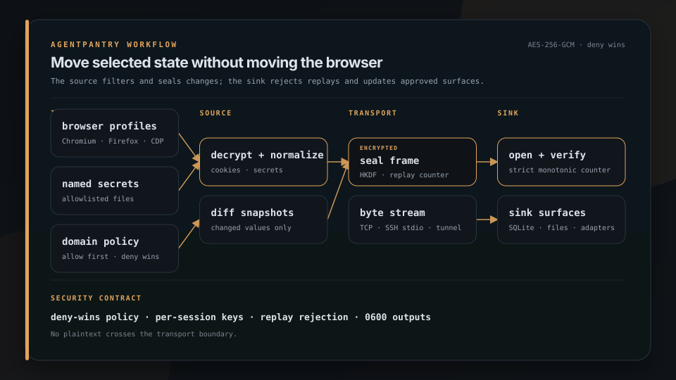
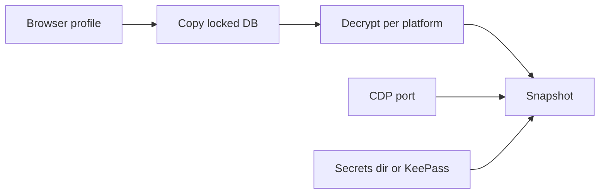
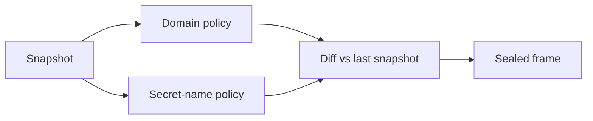
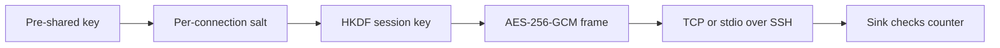
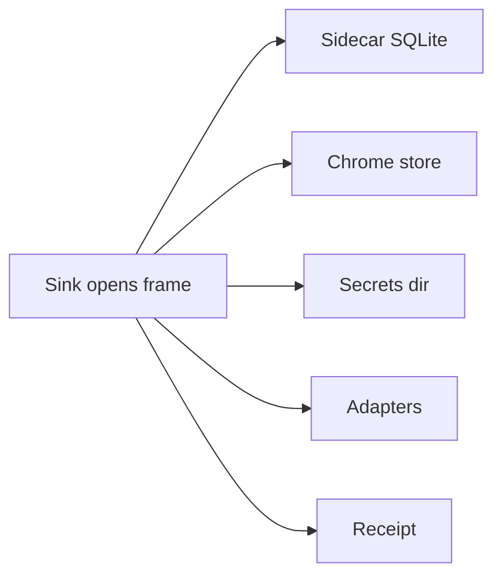
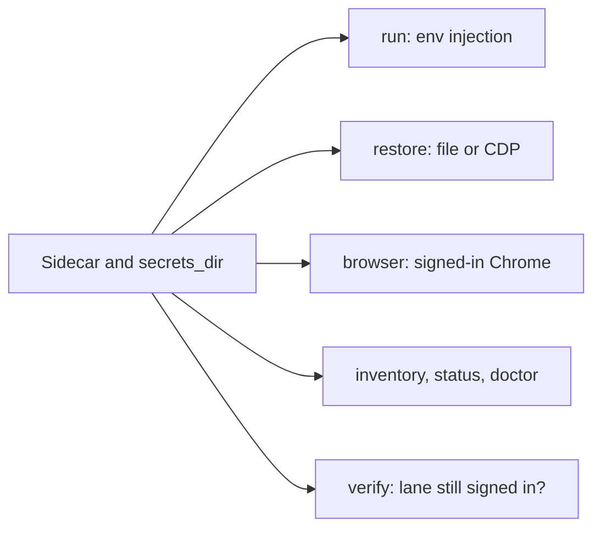

<p align="center">
  
</p>

<h1 align="center">Agent Pantry</h1>

<p align="center">
  
</p>

<p align="center">
  <strong>Your agent machine needs your logins. Pantry ships them sealed.</strong>
</p>

<p align="center">
  Opt-in browser session and secret sync for AI agent hosts: AES-256-GCM frames, allowlisted domains, source to sink. Not a password manager and not a cloud vault. One local Go binary.
</p>

<p align="center">
  <a href="https://brigade.tools/agentpantry">Website</a> · <a href="#install">Install</a> · <a href="https://brigade.tools">Brigade hub</a>
</p>

<p align="center">
  
  
  
  
</p>

Agents run on a different machine than the one you browse on. Your logins and API keys live on the daily driver, the laptop or desktop where you are already signed in. Copying cookie files across by hand breaks when a session refreshes, and it leaks into shell history, dotfiles, and git.

Agent Pantry reads sessions and named secrets on the daily driver and writes them where the agent runs. Its one promise: only domains on your allowlist and secrets you name ever leave, every connection is sealed with its own key, and a deny entry always beats an allow entry.

<p align="center">
  
</p>

<p align="center"><em>Source → seal → sink. Opt-in domains only.</em></p>

## Install

```bash
go install github.com/escoffier-labs/agentpantry/cmd/agentpantry@latest
# or via Brigade
brigade add pantry
```

```bash
agentpantry init
agentpantry keygen
agentpantry doctor
agentpantry status
```

## How it works

| # | Stage | The question it answers | Where in the code |
|---|---|---|---|
| 1 | [Capture](#1-capture) | What gets read on the daily driver? | `internal/vault`, `internal/ffvault`, `internal/cdpvault`, `internal/secretsrc`, `internal/keepass` |
| 2 | [Filter](#2-filter) | What is allowed to leave? | `internal/policy`, `internal/cookie`, `internal/secret`, `internal/webstorage`, `internal/source` |
| 3 | [Seal and carry](#3-seal-and-carry) | How does it travel, and who can open it? | `internal/transport`, `internal/pair`, `internal/keyfile` |
| 4 | [Land](#4-land) | Where does it end up on the agent machine? | `internal/sink`, `internal/surface`, `internal/receipt` |
| 5 | [Use](#5-use) | How does the agent actually use it? | `cmd/agentpantry`, `internal/runenv`, `internal/browser` |

The source role runs stages 1 to 3 on the daily driver. The sink role runs stages 3 and 4 on the agent machine. Stage 5 is a set of sink-side commands.

## 1. Capture

*What gets read on the daily driver?*



### Copy the locked cookie store

The Chromium and Firefox cookie databases are copied to a private temp file before reading, so a running browser's lock never blocks the source. The temp copy is removed after the read.

Source: `internal/dbcopy/dbcopy.go`

### Decrypt per platform

Linux Chromium values decrypt with the passphrase from the freedesktop Secret Service, falling back to the fixed `peanuts` key. Windows Chromium uses the DPAPI-unwrapped key from the profile's `Local State`. Firefox cookies are plaintext.

Source: `internal/vault/linux_chromium.go`, `internal/vault/windows_chromium.go`, `internal/ffvault/firefox.go`

### Ask Chrome directly for app-bound cookies

For Chrome 127+ `v20` cookies the key is no longer recoverable from `Local State`. A `kind = "cdp"` browser entry connects to a loopback DevTools port, and Chrome does its own decryption. With `capture_localstorage = true` the same connection also reads `localStorage` from tabs that are already open, without navigating them.

Source: `internal/cdpvault/cdp.go`

### Read named secrets

Each regular, non-hidden file in `secrets_dir` becomes one secret. Dotfiles such as `.env` are skipped. KeePass entries become secrets only when they carry the `keepass_tag` tag, which defaults to `agentpantry`.

Source: `internal/secretsrc/secretsrc.go`, `internal/keepass/keepass.go`

The live cookie database is never opened directly.

## 2. Filter

*What is allowed to leave?*



### Apply the domain policy

A cookie host must match `domains.allow` and must not match `domains.deny`. An empty allow list permits nothing. `localStorage` origins pass through the same policy, and non-http(s) origins are dropped.

Source: `internal/policy/domain.go`, `internal/source/source.go`

### Apply the secret-name policy

`[secret_names]` takes exact names. Deny overrides allow. An empty allow list permits every secret in the configured `secrets_dir` or tagged KeePass entry set, because configuring that source is the opt-in.

Source: `internal/policy/names.go`

### Send only the difference

The source diffs each snapshot against the last one it sent, so only changes move. If a secrets or `localStorage` source cannot be read in a cycle, the sink keeps what it has instead of receiving deletes. A reconnect resends full state.

Source: `internal/cookie/diff.go`, `internal/secret/diff.go`, `internal/webstorage/diff.go`

### Preview with a dry-run plan

`agentpantry source --dry-run` prints what a config would read and where it would send it. It uses the config and file metadata only. It does not load the key, read a cookie, or contact the peer.

Source: `cmd/agentpantry/sourceplan.go`

An empty `domains.allow` list syncs no cookies, and a `domains.deny` match wins over any allow match.

## 3. Seal and carry

*How does it travel, and who can open it?*



### Share one key

Both ends hold the same 32-byte pre-shared key, stored hex-encoded in a `0600` file. `keygen` writes it, or `pair` derives it from a one-time `XXXX-XXXX` short code with SPAKE2. Compare the confirmation fingerprint printed on both ends before the first sync.

Source: `internal/keyfile/keyfile.go`, `internal/pair/pair.go`

### Start each connection with a fresh salt

Every connection begins with a random 16-byte salt. Over TCP the sink issues it. Over `--stdio` the source does. The session key is HKDF-SHA256 of the pre-shared key and that salt, so a frame captured in one session fails to open in another.

Source: `internal/transport/handshake.go`, `internal/transport/envelope.go`

### Seal each payload as a frame

The payload is one JSON object holding cookie, secret, and `localStorage` diffs. It is sealed with AES-256-GCM as `counter || nonce || ciphertext`, with the counter bound as additional data, then written length-prefixed. Frames are capped at 8 MiB.

Source: `internal/transport/envelope.go`, `internal/transport/frame.go`, `internal/wire/wire.go`

### Carry it over TCP or SSH

A TCP source reconnects with capped backoff from 1s to 30s. For a tunnel, pipe it: `agentpantry source --stdio | ssh sink.example agentpantry sink --stdio`. Over TCP the sink serves at most 32 concurrent connections and waits 30 seconds for the first authenticated frame.

Source: `cmd/agentpantry/main.go`

### Rotate the key without downtime

`rotate-key` on the sink keeps the previous key as `psk.key.old`, and the sink accepts either key until `rotate-key -finish` retires the old one. Details are in [docs/key-management.md](docs/key-management.md).

Source: `internal/transport/fallback.go`, `internal/keyfile/keyfile.go`

A frame with an equal or lower counter is rejected.

## 4. Land

*Where does it end up on the agent machine?*



### Write the surfaces

The `surfaces` list in the sink config selects destinations. `sidecar` is the default: a plaintext SQLite database holding the current cookie set. `chrome` re-encrypts cookies into a Chrome Cookies store that is not running. `secrets` writes one file per secret.

Source: `internal/sink/sink.go`, `internal/surface/sidecar.go`, `internal/surface/chromestore.go`, `internal/surface/secretdir.go`

### Write the native files tools already read

`[[adapters]]` blocks add `netscape` (curl-style `cookies.txt`), `storagestate` (Playwright and Puppeteer), `gh` (GitHub CLI `hosts.yml`), `openclaw` (`auth-profiles.json`), and `hermes` (an Agent Pantry bundle directory). `gh` and `openclaw` are merge-only and upsert-only, so a missing secret never deletes a working login.

Source: `internal/surface/netscape.go`, `internal/surface/storagestate.go`, `internal/surface/ghhosts.go`, `internal/surface/openclawauth.go`, `internal/surface/hermes.go`

### Record a receipt

With `[receipts] enabled = true`, each send or apply appends one JSON line to a hash-chained log with an HMAC bound to the pre-shared key. Receipts hold counts and a digest, never values. `agentpantry receipts verify` walks the chain.

Source: `internal/receipt/receipt.go`

Files the sink writes for the sidecar, secrets, adapters, and receipts are mode `0600`.

## 5. Use

*How does the agent actually use it?*



### Inject secrets into one process

`agentpantry run -- <command>` reads the synced secrets, applies the deny-wins `[secret_names]` policy, and starts the command with the permitted values in its environment. Nothing is written to a staging file. Loader variables such as `PATH` and `LD_PRELOAD` are refused.

Source: `cmd/agentpantry/run.go`, `internal/runenv/runenv.go`

### Restore into a tool's format

`agentpantry restore --to` writes a sidecar backup into `netscape=`, `chromium=`, `storagestate=`, or a loopback `cdp=` target. `desktop-app=` targets are inspection-only and need `--dry-run`.

Source: `cmd/agentpantry/main.go`, `cmd/agentpantry/desktopapp.go`

### Launch a signed-in automation browser

`agentpantry browser` starts Chrome on a loopback debugging port, and loads cookies and `localStorage` from the sidecar. It stops Chrome when it returns. Pass `--keep-open` to leave the endpoint up for a scraper to attach. The profile is a throwaway directory unless you pass `--profile`.

Source: `internal/browser/browser.go`, `cmd/agentpantry/main.go`

### Check what is there

`inventory` summarizes a sidecar by host and near-expiry cookies, `status` prints role, peer, surfaces, and last sync, and `doctor` validates the key, config, and role-specific setup. None of them print values.

Source: `internal/doctor/doctor.go`, `cmd/agentpantry/main.go`

### Check that a lane is still signed in

`agentpantry verify -lane http://127.0.0.1:9224 -domain example.com https://example.com/` opens one tab in that browser, reads the title, final URL, and how much text came back, then closes the tab. It exits 0 for `ok`, 1 for `challenge`, `empty`, or `off_domain`, and 2 when the check could not run. Cookie counts cannot answer this: a clearance cookie only works in the browser that earned it. `-domain` is required and also holds the final URL, so an expired session that bounces to an external sign-in reports `off_domain`. `status -all` summarizes every per-profile config under `profiles/`.

Source: `internal/lane/lane.go`, `cmd/agentpantry/verify.go`

### Handing off from a public-web reader

Some agent web readers deliberately refuse signed-in profiles and stop with a "requires auth" or challenge result. That is where agentpantry takes over. It keeps a named local browser lane signed in, and the agent reads the authenticated page there. Run `verify` first to confirm the lane is still signed in:

```bash
agentpantry browser -config ./sink.toml --profile ~/lanes/research --port 9223 --keep-open
```

The `--profile` directory persists between launches, so the lane stays warm. To refresh a lane you already drive, run `agentpantry restore -config ./sink.toml --to cdp=http://127.0.0.1:9223`. Match the browser's user agent, timezone, and language to where the session was minted, or the site may flag it anyway.

## Quickstart

On the sink (agent machine):

```bash
agentpantry init --role sink
agentpantry keygen          # or: agentpantry pair --role sink
# copy ~/.config/agentpantry/psk.key to the source machine
# edit config.toml: set peer to the bind address, e.g. 0.0.0.0:8787 over your VPN
agentpantry doctor
agentpantry sink
```

On the source (daily driver):

```bash
agentpantry init --role source
# copy the psk.key from the sink into ~/.config/agentpantry/psk.key
# or: agentpantry pair --role source --code ABCD-EFGH --peer <sink-address>
# edit config.toml: set peer to the sink address, add a [[browsers]] block and domains.allow
agentpantry doctor
agentpantry source
```

`init` writes a commented config and refuses to overwrite an existing one unless you pass `--force`. `doctor` validates the result and warns about misspelled config keys. Browser kinds, Windows notes, and app-bound Chrome are covered in [docs/configuring-sources.md](docs/configuring-sources.md). Copyable configs live in `examples/`.

## Reference

### What can touch your sessions

Every path that reads, writes, or exposes cookies and secrets, and what limits it.

| Path | Reads values? | Writes values? | Guard |
|---|---|---|---|
| Source read: Chromium and Firefox stores | Yes | No, only a private temp copy that is removed | `domains.allow` and `domains.deny`, explicit `cookie_path` |
| Source read: CDP (`kind = "cdp"`) | Yes, including `localStorage` when enabled | No | Loopback URL only, `capture_localstorage` is off by default |
| Source read: `secrets_dir` and KeePass | Yes | No | `[secret_names]`, KeePass tag opt-in, `0600` key file |
| Wire (TCP or `--stdio`) | Sealed only | Sealed only | Pre-shared key, per-connection HKDF key, strict counter |
| Sink sidecar | Read by `inventory`, `restore`, `browser` | Yes, plaintext | Mode `0600`, sink bind defaults to loopback |
| Sink `chrome` surface | No | Yes, re-encrypted | Opt-in, intended for a profile that is not running |
| Sink `secrets` surface | Read by `run` | Yes, one file per secret | Mode `0600`, names with path separators or `..` skipped |
| Adapter `netscape` | No | Yes, `cookies.txt` | Mode `0600` |
| Adapter `storagestate` | No | Yes, cookies and `localStorage` | Mode `0600`, seeds from its own file on restart |
| Adapter `gh` | No | Yes, token in `hosts.yml` | Merge-only, upsert-only |
| Adapter `openclaw` | No | Yes, profiles in `auth-profiles.json` | Merge-only, invalid JSON values skipped |
| Adapter `hermes` | No | Yes, bundle directory | Agent Pantry owns the subtree |
| `run` | Yes, `secrets_dir` | Child environment only, never a file | Deny-wins policy, loader variables refused |
| `restore` | Yes, sidecar | Yes, to one explicit target | Domain narrowing, loopback-only `cdp=`, refuses to overwrite a non-`storageState` file, `desktop-app=` refuses writes |
| `browser` | Yes, sidecar | Yes, into the Chrome it launches | Loopback port, throwaway profile by default |
| `verify` | Title, final host, and text length of one page | No | Loopback lane, `-domain` scope on the start and final URL, tab closed, no cookie values, headers, or body text printed |
| `inventory`, `status`, `doctor` | `inventory` opens the sidecar | No | Print no values, `inventory` never creates a store |
| Receipts | No | Counts and digests only | HMAC chain, mode `0600`, no values |

### Commands

- `init`: write a commented starter config (`-role source|sink`).
- `keygen`: generate the pre-shared key both endpoints share.
- `pair`: bootstrap the key with a one-time SPAKE2 short code.
- `rotate-key`: rotate the pre-shared key in place, and `-finish` retires the old key.
- `source`: run on the daily driver, watch browsers, and push sealed diffs.
- `sink`: run on the agent machine, receive diffs, and apply them to surfaces.
- `doctor`: validate the config, key, and role-specific setup.
- `status`: print the active role, peer, surfaces, and last sync. `-all` summarizes every per-profile config.
- `verify`: check that a running lane browser still has a working session for one domain.
- `inventory`: summarize a backup store with per-host counts and near-expiry cookies.
- `restore`: materialize cookies from a sidecar backup into one target.
- `browser`: launch an automation Chrome pre-seeded with a session.
- `run`: inject synced secrets into a child process environment.
- `receipts`: show or verify the local hash-chained sync receipt log.
- `install-service`: install a systemd user unit, or print a task command on Windows.
- `version`: print version and build metadata.

### Detail docs

- [Configuring sources and browsers](docs/configuring-sources.md): browser kinds, Windows, app-bound Chrome over CDP
- [Operating](docs/operating.md): doctor, receipts, status, `status -all`, `verify`, inventory, run, restore, desktop app inspection, stdio, source dry-run plan, reliability, release packaging
- [Key management and pairing](docs/key-management.md): session handshake, short-code pairing, rotating the pre-shared key
- [Surfaces, secrets, and adapters](docs/surfaces-and-adapters.md): surfaces, named secrets, `localStorage`, the automation browser, adapter config
- [Design notes](docs/design-notes.md): the original overview and "Why not something else?"
- [Threat model](docs/threat-model.md): what is protected, operator duties, known limits

## What agentpantry is not

Agent Pantry is not a password manager, a hosted service, a daemon, or a
credential-harvesting tool.

It does not:

- store or generate your passwords, or hand out credentials on request
- sync a cookie until you add its domain to `domains.allow`
- run in the background as a system service unless you install one yourself
- log cookie values, token values, pre-shared keys, or secret contents
- reach out to any network it was not configured to dial
- pull sessions off machines you do not control

It moves your own authenticated state between your own machines, and only the
state you explicitly allow.

## Security

- Domains are opt-in. No cookie syncs until its domain is in `domains.allow`.
  An empty allow list permits nothing, and a `domains.deny` entry overrides any
  allow match. Secrets sync only from a configured `secrets_dir` or tagged
  KeePass entries, gated by `[secret_names]`.
- The sidecar SQLite is plaintext, mode 0600. Treat the sink like a secret
  store: anyone who can read that file can impersonate the synced sessions.
- The pre-shared key file is written 0600 and must be kept off shared storage.
- Cookie values are never logged. Cookie names and hosts may appear in stderr
  expiry warnings during sync and in `inventory --json` near-expiry output.
  Values live only in memory, in the encrypted frames on the wire, and in the
  sidecar.
- Transport is AES-256-GCM with a shared key. Run it over Tailscale, Twingate,
  a LAN you trust, or an SSH tunnel.
- The sink defaults to loopback. Both `doctor` and `agentpantry sink` startup
  warn when the bind address exposes the sink beyond loopback, except for a
  Tailscale address with `[tailnet]` enforcement configured.

### Tailscale identity gate

On the sink, `peer = "tailnet:8787"` resolves this node's Tailscale IPv4 at
startup. `tailnet6:8787` selects IPv6. Resolution requires a running local
Tailscale daemon and never falls back to a wildcard. Add identity selectors:

```toml
[tailnet]
allow_nodes = ["nXXXXXXCNTRL"]
allow_tags = []
allow_user_ids = []
allow_loopback = false
```

The presence of `[tailnet]` enforces identity checks before the sink sends its
salt, including on explicit IP binds. At least one nonblank selector is required.
Stable node IDs select individual nodes. Tags require tight Tailscale `tagOwners`.
Numeric UserIDs (quoted decimal strings) allow every untagged device of that user.
Tagged devices never match a UserID. Names do not authorize connections.
`doctor` checks LocalAPI, Running state, the self bind, selectors, and offline or
missing allowed nodes. Without `[tailnet]`, every reachable tailnet member can
reach the pre-auth surface.

`pair -role sink -bind tailnet:8788 -config <sink-config>` uses the same gate
before SPAKE2 attempt accounting and preflights it before printing the code.
Denied connections receive no bytes. `allow_loopback = true` explicitly bypasses
identity checks only when both socket addresses are loopback: it trusts every
local process and any SSH tunnel terminating locally, without verifying a
Tailscale identity. `--stdio` is unchanged. The PSK remains mandatory for sync.
Restrict the sink port to the source tag with a Tailscale grant or ACL as well.

## Acknowledgements

Hat tip to [agentcookie](https://github.com/mvanhorn/agentcookie) for the spark.

For tagged 1Password service-account secrets, see [source configuration](docs/configuring-sources.md#1password-service-account).
